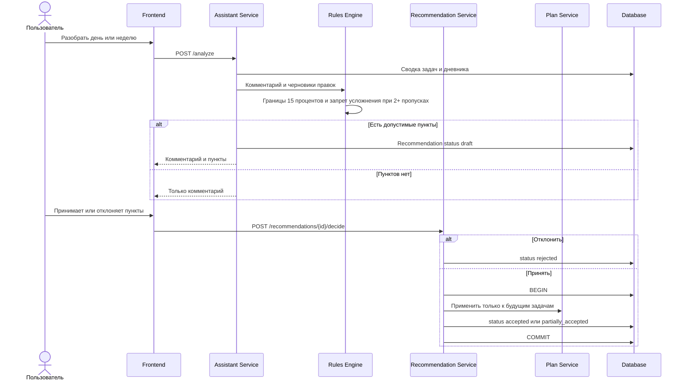

# FT-11. Предложение по корректировке тренировок

Каждый пункт содержит задачу, предлагаемое изменение и причину.

Допустимые изменения: уменьшить или немного увеличить число подходов, заменить упражнение более простым вариантом того же характера, перенести тренировку на другой день.

За одну принятую рекомендацию суммарный объём тренировок недели изменяется не более чем на 15 процентов.

Если за семь дней пропущены две тренировки или больше, усложнение предлагать нельзя.

