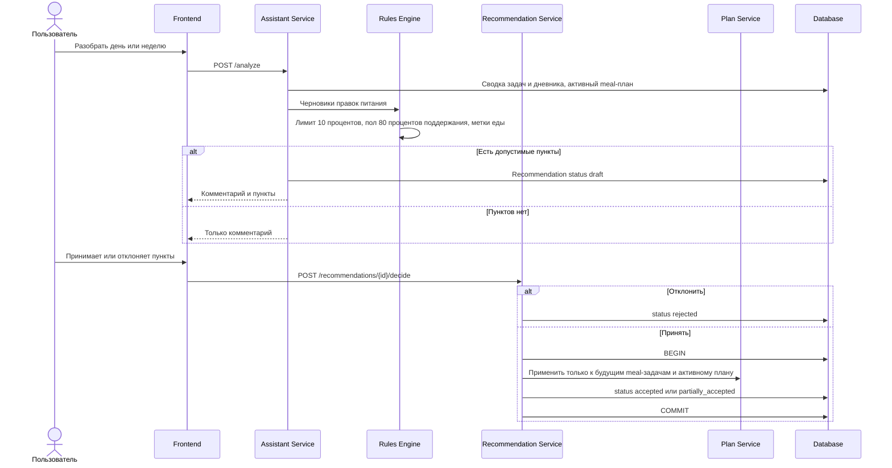

# FT-12. Предложение по корректировке питания

Каждый пункт содержит задачу, предлагаемое изменение и причину.

Допустимые изменения: заменить пример блюда или сдвинуть суточную калорийность.

За одну принятую рекомендацию калорийность изменяется не более чем на 10 процентов.

Предложение не опускает калорийность ниже 80 процентов от рассчитанного поддержания. Если шаг упирается в границу, он обрезается, и пользователь видит это в причине.

Метки ограничений не дают предложить запрещённый тип нагрузки. Для питания учитываются только те ограничения, которые заданы метками, а не догадкой модели.

