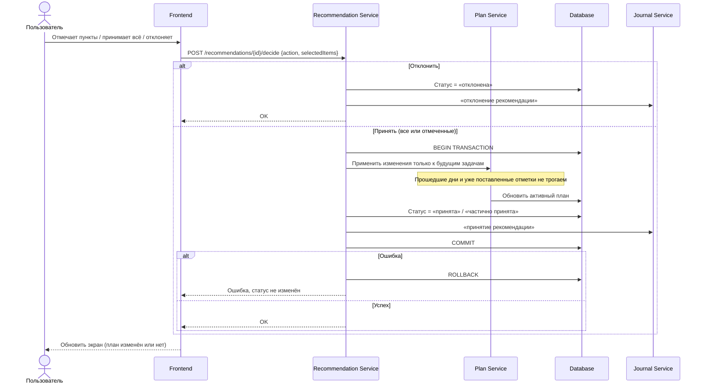

# FT-13. Подтверждение и применение правки

Статусы рекомендации: черновик, принята, частично принята, отклонена.

Пользователь принимает все пункты, принимает отмеченные или отклоняет рекомендацию.

Принятие выполняется одной транзакцией: обновляются будущие задачи активного плана, статус рекомендации и журнал.

Уже прошедшие дни и уже поставленные отметки не переписываются.

Ни языковая модель, ни клиентский скрипт не записывают правку в базу в обход серверной проверки.

