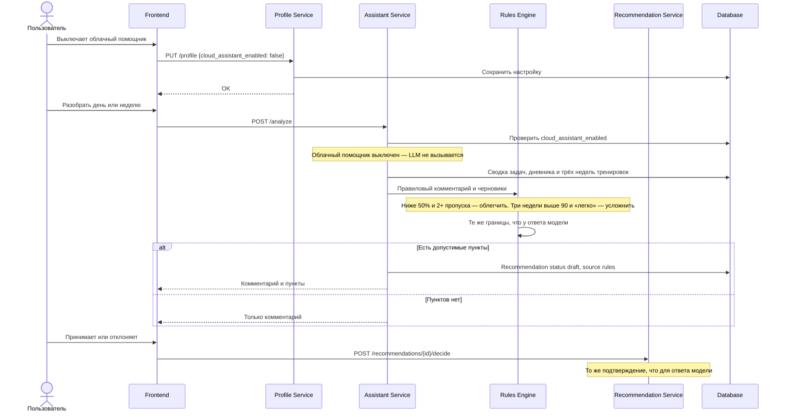

# FT-14. Работа без облачного помощника

В настройках профиля облачный помощник выключается (`cloud_assistant_enabled = false`).

Планы, отметки задач и процент соблюдения продолжают работать без внешней модели.

Остаются правильные подсказки:

- если процент тренировок за семь дней ниже 50 и пропущены не менее двух занятий — предлагается облегчить неделю;
- если три недели подряд процент тренировок выше 90 и самочувствие отмечено как «легко» — предлагается небольшое усложнение.

Правильная подсказка проходит те же границы и то же подтверждение, что и ответ модели: лимит объёма 15%, запрет усложнения при двух и более пропусках за семь дней, статус черновика и `POST /recommendations/{id}/decide`.

