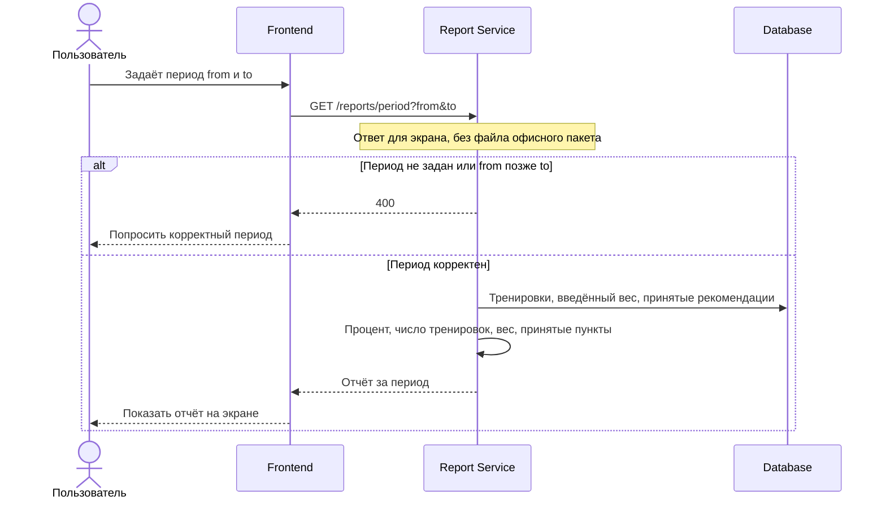

# FT-15. Отчёт за период

Пользователь задаёт период и видит процент соблюдения тренировок, число тренировок, введённый вес и список принятых корректировок.

Отчёт открывается на экране. Сервер отдаёт данные для этого экрана и не формирует файл офисного пакета.

Процент считается по тренировкам периода: выполнено — 1, частично — 0.5, пропущено и без отметки — 0. Число тренировок — задачи тренировок в периоде. Вес — записи дневника, где вес введён. В список попадают пункты рекомендаций со статусом «принята» или «частично принята», чей период пересекается с заданным. У частичного принятия только отмеченные пункты. Черновики и отклонённые рекомендации не входят.

