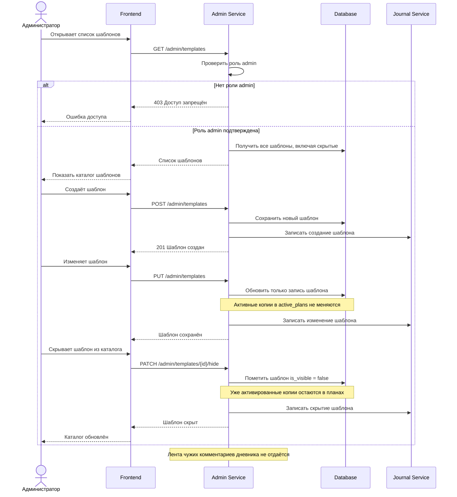

# FT-16. Администрирование шаблонов

Роль администратора позволяет создать шаблон, изменить его и скрыть из каталога.

Изменение шаблона не меняет активные копии, которые пользователи уже ведут: у копии плана остаются свои название, уровень и описание, сохранённые при активации.

Администратор не получает ленту чужих комментариев дневника в первой версии.

Отчёт за период открывается на экране и не требует отдельного офисного пакета: сервер отдаёт данные для экрана и не формирует файл.

Запрос без токена получает 401. Запрос без роли admin получает 403.

